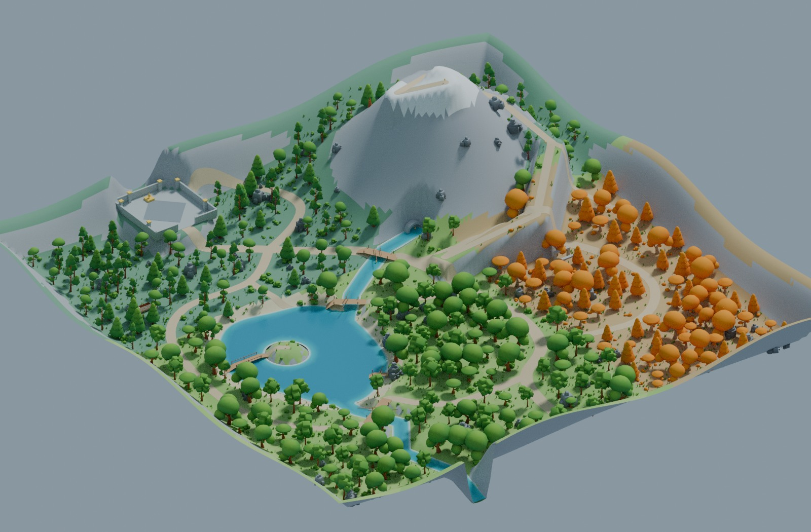
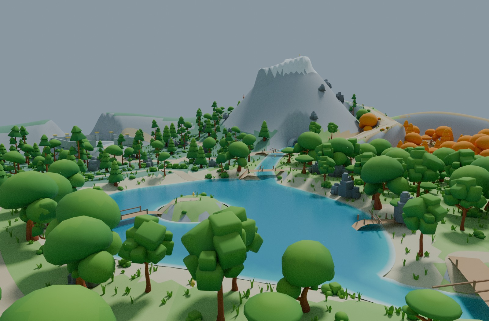
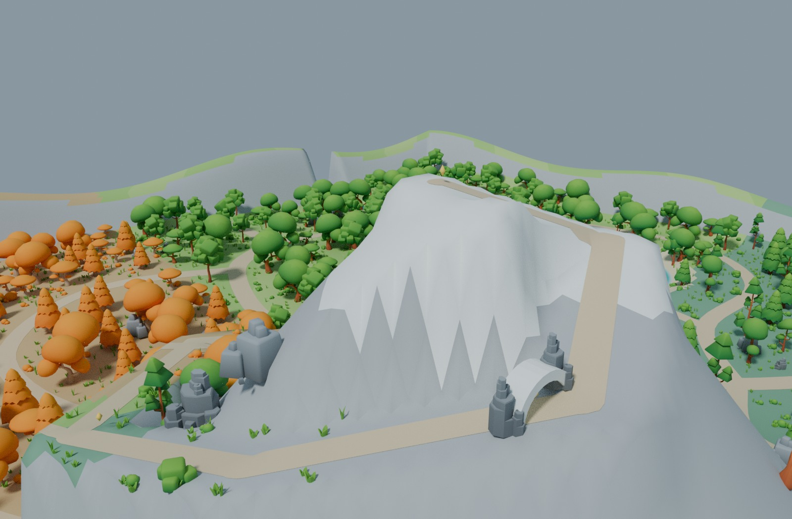

# Jehad V1.2 — the expansive valley

Scene: `Assets/_Project/Scenes/Jehad/Jehad_V1.2.unity`  
Unity: **6000.3.27f1**, URP 17.3. Open the scene and press Play after import.

The user requested another substantial expansion and a stronger nature-art pass.
The main landscape now spans **240 × 240 m (57,600 m²)**, approximately **11.76×
the V1.1 clearing footprint**. Its highest ground is about **52.25 m** above world
zero. This is one continuous landscape with four visual districts and a separate
boss-area prefab; there are no extra loading scenes or additional abilities.

| Environment | Exploration features |
|---|---|
| Sunlit meadow | Rolling ground, flowers, broad reconnecting trails and the entry clearing |
| Amber woodland | Three autumn tree shapes, mushroom ring, root hollow and an overgrown ruin |
| Pine uplands | Conifers, stone circle, wooded loops and the boss approach |
| Alpine mountain | A cut mountain trail, snow line, open stone arch and summit lookout |

## Water and landmarks

An irregular lake surrounds a small island, reached by a timber footbridge.
An upper river joins the lake; a winding outlet continues south. There are four
river/island crossings plus an old shore jetty. Banks and the lake bottom are
actual terrain; the water uses an animated URP surface shader with shoreline
foam. It is intentionally shallow enough to wade, so this step adds no swimming
system. Two real open arch meshes provide the spring grotto and snowy trail
landmarks. The boss landing stays clear for the existing Guardian encounter.

## Nature art and rendering

- **337 trees** with real reduced-detail distant meshes and native LODGroups.
- **3,509 grass/shrub instances** in 138 spatial batches, sharing source meshes.
- Detailed gradient-textured KayKit trees, multiple silhouettes, orange autumn
  variants, bushes, grass and rocks. One original 1024px atlas serves the pack.
- Existing credited Kenney flowers, mushrooms, log and stump remain reusable.
- Four terrain tiles have matching MeshColliders; source tree trunks and major
  rocks use simple colliders. Grass does not block movement. Runtime speed has
  not been measured in Unity.

Imported art is CC0 and credited to **Kay Lousberg** and **Kenney**. Pack licenses,
pinned download URLs and checksums accompany the source assets. The team-authored
work is the layout, terrain, structures, water shader and integration code.

## Review controls and hidden relics

| Control | Action |
|---|---|
| WASD | Move relative to the review camera |
| Left Shift | Sprint |
| Space | Jump |
| Hold middle mouse | Orbit the camera |
| Mouse wheel | Zoom |
| R | Return to the starting clearing |

Sixteen hidden relics now have real trigger pickups, a once-only collection guard,
a review counter and a gentle rotation/bob animation. They preserve collection
through area retries and reset on `RetryScope.NewGame` through the existing
`IResettable` interface. Returning with R preserves found relics.

The review controller and its small counter are isolated in Testing. They do not
replace Tariq's production player or HUD. `HiddenRelicV12` exposes a discovery
UnityEvent for integration without changing Core or GameEvents.

Secret locations for review (spoilers)

| Relic | Hiding place | World position |
|---|---|---|
| WildflowerCache | A flower-screened entrance clearing | (-14, 4.73, -100) |
| AncientRoots | A sheltered hollow beside a spreading tree | (-76, 4.62, -70) |
| MushroomRing | A mushroom ring behind the amber grove | (-90, 4.42, -24) |
| RuinedGarden | A small ruin screened by autumn shrubs | (-65, 3.24, -7) |
| SpringGrotto | A rock overhang at the river spring | (-28, 7.57, 38) |
| UnderWillowBridge | A shallow-water route below the upstream crossing | (-5, 4.79, 31) |
| ReedIsland | The lake island reached by a timber footbridge | (57, 5.35, 2) |
| LilyCove | A concealed lakeside cove | (78, 3.09, -27) |
| OldJetty | A forgotten landing behind reeds | (39, 2.36, -31) |
| FallenPine | A rock-screened clearing in the pine forest | (87, 3.51, 53) |
| MoonstoneCircle | A stone circle at the end of the northern loop | (4, 5.84, 100) |
| PineHollow | A secluded grove below the mountain shoulder | (-6, 7.81, 62) |
| MountainShelf | A side shelf on the ascent | (-86, 26.15, 35) |
| SummitSanctuary | The summit lookout above the valley | (-56, 53.20, 58) |
| SnowArch | A rocky arch beside the high trail | (-66, 40.28, 78) |
| CliffLookout | A western spur overlooking the amber grove | (-100, 6.70, 6) |

## Verification and Unity review

Static validation passed for YAML/GUIDs, native mesh buffers and bounds, source
OBJ positions/normals/UVs/index equivalence, real tree LOD reductions, component
references, all foliage instance bounds, 16 unique pickup IDs, and conservative
terrain approaches to all secrets and the boss entry. The three new C# files
also passed a C# syntax-tree parse. This is not Unity type checking or execution.

**Not run here:** Unity C#/shader compilation, asset import, PhysX cooking,
play testing, camera clearance, frame-time profiling, lighting review or NavMesh
baking. There is no connected Unity Editor in this environment. Please verify
those before treating this as a release-ready scene. Water flow, grass instancing,
trigger collection and camera behaviour require actual Play-mode verification.

Enemy/boss agents, production HUD, game flow, audio and ability interactions are
still integration work. Enemy, retry, ability-source and Heart anchors remain
available. The release scene and build list are unchanged. Earlier V1.0/V1.1
scenes and assets are preserved.

## Previews and rebuild

These are **Blender geometry previews with illustrative lighting**, not Unity
screenshots or performance evidence:

Rebuild and static-validation instructions: `Tools/Jehad/V1_2/README.md`.
The machine-readable report is `Jehad_V1.2.validation.json` beside this note.

Next after review: address Unity navigation/camera/performance findings, then
continue the flow/menu/retry and production-system integration checkpoint.
