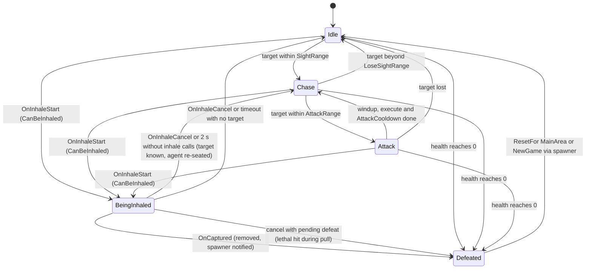
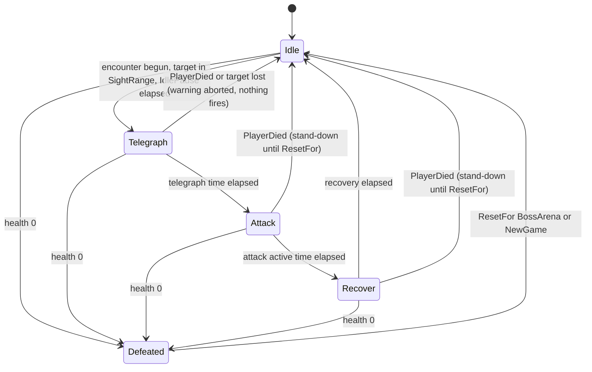
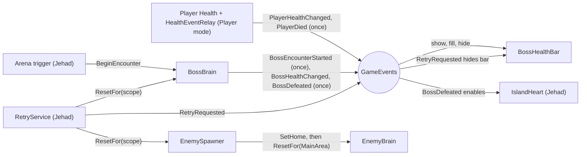

# Combat and AI: systems status and verification (Muhammad)

Contribution to `docs/phase2/checkpoint.md` (Systems implementation status, Playtest report, Production update).
Owner: Muhammad Jaddoua. Scope: issues #4 to #9, #19, #22. Written 14 Nov 2026. Evidence marked TODO is still to be captured.

## 1. Scope and status

| Issue | Title | Implemented | Self-tested | Sandbox play-tested | PR |
|---|---|---|---|---|---|
| #4 | Health/damage + hit-once attack ids | Yes | Health 10/10, Combat 17/17 | Yes | #25 (open) |
| #5 | Sword attack | Yes | Combat 17/17 | Yes | #26 (open) |
| #6 | Shared projectile: Bow + Fire | Yes | Combat 17/17 | Yes | #27 (open) |
| #7 | Enemy FSM + 3 variants + IInhalable | Yes | Combat 17/17 | Yes | #28 (open) |
| #8 | Enemy spawners (replenish) | Yes | Spawner 9/9 | Yes | PR pending (`feature/8-enemy-spawner`, not pushed) |
| #9 | Boss FSM, telegraphs, boss bar | Yes | Boss 20/20, BossBar 10/10 | Yes | PR pending (`feature/9-boss-fsm`, not pushed) |
| #19 | Key models (3 enemies + boss, graybox) | Yes (primitive graybox prefabs) | n/a | Yes | PR pending (`feature/19-graybox-prefabs`, not pushed) |
| #22 | Profiler capture + one improvement | No | n/a | n/a | Blocked on the integration build (#20) |

Related contract PR: #24 (`IAbilityAttack`, contract log). Branches are stacked: #24, then #4, #5, #6, #7, #8, #9, #19.
Reviewer on all open PRs: Tariq.

Not in scope of this document: Player, Inhale, HUD (Tariq); world, flow, retry, audio (Jehad).

## 2. Systems implementation status

| System | What it does | Where (`Assets/_Project/Scripts/`) |
|---|---|---|
| Health and damage | Shared `Health` implements `IDamageable`. Rejects same-team, dead, zero-damage and invulnerable hits. Remembers the last 32 attack ids. | `Combat/Health.cs` |
| Event bridge | `HealthEventRelay` (Player or Boss mode) turns health changes into `GameEvents`. Death event raised once, re-armed when health is above 0 again. | `Combat/HealthEventRelay.cs` |
| Sword | `SwordAttack` moves a `MeleeHitbox` and calls `Swing`. Hit window 0.15 s, one `AttackId` per swing, per-swing victim set. Gizmo is yellow idle, red active. | `Combat/SwordAttack.cs`, `Combat/MeleeHitbox.cs` |
| Bow and Fire | One `Projectile` component, values from `AbilityDefinition`. `ProjectileAttack` handles per-power cooldown. | `Combat/Projectile.cs`, `Combat/ProjectileAttack.cs` |
| Attack entry point | `AbilityAttackRunner.TryUse` dispatches to the `IAbilityAttack` handler (contract from PR #24). | `Combat/AbilityAttackRunner.cs` |
| Enemy FSM | `EnemyBrain` with Idle, Chase, Attack, BeingInhaled, Defeated. Data from `EnemyDefinition`. Attack behaviour is a strategy (`MeleeEnemyAttack`, `RangedEnemyAttack`). | `AI/EnemyBrain.cs`, `AI/EnemyDefinition.cs`, `AI/EnemyAttackBehaviour.cs`, `AI/MeleeEnemyAttack.cs`, `AI/RangedEnemyAttack.cs` |
| Spawners | `EnemySpawner` owns one enemy instance and respawns it once after capture or defeat. Shared cap of 6 active normal enemies. | `AI/EnemySpawner.cs` |
| Boss FSM | `BossBrain` with Idle, Telegraph, Attack, Recover, Defeated. Slam or ranged shot. Not inhalable. Data from `BossDefinition`. | `AI/BossBrain.cs`, `AI/BossDefinition.cs` |
| Boss telegraph visual | Slam ring scaled by `TelegraphProgress`, body colour pulse. | `AI/BossTelegraphVisual.cs` |
| Boss health bar | Listens to `GameEvents` only. Hidden by `CanvasGroup` alpha. | `UI/BossHealthBar.cs` |

### 2.1 Physics and collision

- Layers are constants in `Core/Layers`: Player 8, Enemy 9, Boss 10, PlayerAttack 11, EnemyAttack 12, Environment 13.
- Attacks pass an explicit `LayerMask` (`hitMask`) instead of relying on the collision matrix alone. Team filtering is done twice: by layer and by `Health.Team`.
- Projectile: `SphereCastNonAlloc` sweep between positions each step, so fast projectiles cannot tunnel. Mask is `hitMask | EnvironmentMask`. Owner colliders are ignored. Closest hit wins. Buffer size 8.
- Sword uses `OverlapBoxNonAlloc`, boss slam uses `OverlapSphereNonAlloc`. Both use fixed buffers, so there is no per-frame allocation.
- Enemies and boss use `NavMeshAgent`. The enemy agent is disabled during an inhale and re-seated with `NavMesh.SamplePosition` on cancel.

### 2.2 AI and state-driven logic

Both brains use an explicit `enum State` and a `switch` in `Tick`. See section 3 for the diagrams.

### 2.3 Once-guards

| Event | Guard | Covered by |
|---|---|---|
| Same swing or projectile damages a target twice | `AttackId` memory in `Health` + per-swing victim set + `Projectile._resolved` | Combat self test, play test hit-once rows |
| Capture and defeat both fire | `EnemyBrain.Resolve()` single `_resolved` flag; capture after defeat is rejected; lethal damage during inhale becomes `_pendingDefeat` | Combat self test |
| `OnCaptured` called twice | `_resolved` | Combat self test |
| `PlayerDied` raised twice | `HealthEventRelay._deathRaised` | Health self test |
| `BossEncounterStarted` raised twice | `BossBrain._encounterRaised`, cleared only by `ResetFor` | Boss self test |
| `BossDefeated` raised twice | `BossBrain._defeatRaised`, cleared only by `ResetFor` | Boss self test, play test (once per power) |
| Slam hits the player twice | One `AttackId` + victim set per slam | Boss self test |

## 3. State diagrams

### 3.1 EnemyBrain

Guards: `Resolve()` runs once, so capture and defeat are mutually exclusive. Damage taken while `BeingInhaled` is refunded with `Heal`. `CanBeInhaled` is false after `Resolve()` and while already being inhaled. A defeated enemy is deactivated after a short despawn delay and the spawner owns its reset.

### 3.2 BossBrain

Attack choice at the Idle to Telegraph transition: Slam if flat distance to the player is at most `SlamRange`, otherwise Ranged. Slam telegraph 1.0 s, ranged telegraph 0.9 s. Recovery after slam 1.5 s, after ranged 1.2 s. `ResetFor(MainArea)` is ignored. After Defeated the boss is deactivated after 1.5 s and never destroyed. `ResetFor(BossArena or NewGame)` also returns a live boss to Idle with full health from any other state.

### 3.3 Who raises which GameEvent

Notes: `BossBrain` is its own bridge, so the boss prefab must not carry `HealthEventRelay`. The retry service never resets spawned enemies directly. It resets the `EnemySpawner`, which owns the enemy instance.

## 4. Verification

Verified in sandbox = run, with output seen in Unity. Partial = sandbox only, or simulated. Not verified = not done yet.

| Check | How verified | Result | Evidence | Still needed (owner) |
|---|---|---|---|---|
| Health rejects repeats, dead, same-team, invulnerable | `HealthSelfTest` (edit mode) | Verified in sandbox, 10/10 | Unity console log | Re-run on `main` after merge (Muhammad) |
| P03: all three attacks hit correctly | `CombatSelfTest` 17/17 and play test 45/45: Sword removed 2, Bow 1, Fire 2 from the dummy | Partial | Play test log | Real mouse input through Tariq's ability holder (Tariq, Muhammad) |
| P03: repeated hits (same swing or projectile) | `CombatSelfTest` (swing hits once, projectile single hit and despawn) and play test hit-once rows | Verified in sandbox | Self test and play test logs | Repeat in main scene (Muhammad) |
| P03: enemies chase and attack | Play test: Idle, Chase, Attack seen for Beetle (start 4.9 m), Archer (12 m), Emberling (9.1 m); each damaged the player | Partial | Play test log | Check on the real graybox NavMesh in `Echoheart.unity` (Tariq, integrator) |
| P03: capture and defeat cannot occur twice | `CombatSelfTest`: double `OnCaptured` rejected, defeat then capture rejected, lethal damage during inhale resolves once | Verified in sandbox | Self test log | Real inhale (Tariq, Muhammad) |
| Capture grants ability, defeat does not | Play test: capture simulated through `IInhalable` calls granted Sword; defeat granted nothing | Partial | Play test log | Real inhale (Tariq) |
| Capture each enemy type, replace each power (core verification) | Not run | Not verified | n/a | Fresh-run test with real inhale (Tariq, Muhammad) |
| Blocked inhale (core verification) | Not run | Not verified | n/a | Inhale line of sight (Tariq) |
| Spawner replenish after capture or defeat | `SpawnerSelfTest` 9/9. Play test: beetle respawned after 3.0 s, active count 3, 2, 3 | Verified in sandbox | Self test and play test logs | Place spawners in the main scene (Jehad, Tariq) |
| P05: both boss attacks telegraph | `BossSelfTest` 20/20 (includes telegraph visual). Play test: both attacks telegraph, Telegraph, Attack, Recover seen; slam and shot damaged the player | Verified in sandbox | Play test log | Screenshot of the ring (Muhammad, TODO) |
| P05: each power alone can win | Play test: ideal-case time to kill on the 14 HP boss: Sword 2.7 s, Bow 6.8 s, Fire 5.2 s | Partial (scripted, best case) | Play test log | Three recorded human wins (Muhammad) |
| Boss cannot be inhaled | Boss self test; the boss has no `IInhalable` | Verified in sandbox | Boss self test log | Check with real inhale (Tariq) |
| Melee recovery windows safe | Recover state seen in play test | Partial | Play test log | Human check in recorded wins (Muhammad) |
| `BossDefeated` raised once | Play test: once per power; bar hidden after | Verified in sandbox | Play test log | Heart enable in main scene (Jehad) |
| Death in main area | Play test: `PlayerDied` once, no auto retry, dead player cannot attack | Partial | Play test log | Main-area retry through `RetryService` (Jehad) |
| P05: retry restores encounter | Play test: `ResetFor(BossArena)` cleared projectiles (1 to 0), restored the boss, allowed `BeginEncounter` again, reset arena adds; main-area enemies untouched; `ResetFor(MainArea)` reset all main enemies | Partial | Play test log | Through Jehad's `RetryService` (Jehad, Muhammad) |
| P05: Heart completion happens once | Not run. My side raises `BossDefeated` once | Not verified | n/a | Jehad |
| Boss bar behaviour | `BossHealthBarSelfTest` 10/10 | Verified in sandbox | Self test log | Screenshot in the HUD canvas (Tariq, Muhammad) |
| Performance with enemies and boss | Not run | Not verified | n/a | Profiler capture, section 8 (Muhammad) |

Sandbox play test: `CombatPlayTest` in `Sandbox_Muhammad.unity`, 45 passes, 0 failures, no errors logged during the run. The first run had 3 failures caused by test wait timing only; the second run is the one reported.

Self tests: Health 10, Combat 17, Spawner 9, Boss 20, BossBar 10. All pass, console 0 errors at the last run.

## 5. Balance record

| Value | Before | After | Reason |
|---|---|---|---|
| Bow cooldown (`Ability_Bow`) | 0.6 s | 0.5 s | Bow deals 1 damage per hit and was the slowest power to win with |
| Fire projectile speed (`Ability_Fire`) | 20 | 14 | Fire is the short-range power; a slower bolt separates it from the arrow |
| Sword | dmg 2, cd 0.45 s, range 2 | unchanged | Close-range, highest risk |
| Bow (other values) | dmg 1, range 25, speed 20 | unchanged | |
| Fire (other values) | dmg 2, cd 0.8 s, range 12 | unchanged | |

Player health in the sandbox: 5, invulnerability 0.6 s. Boss (`Boss_Guardian.asset`, defaults): MaxHealth 14, MoveSpeed 2, SlamRange 4, SlamRadius 4.5, SlamDamage 2, SlamTelegraph 1.0 s, SlamRecover 1.5 s, RangedDamage 1, RangedTelegraph 0.9 s, RangedRecover 1.2 s, ProjectileSpeed 12, ProjectileRange 40.

Enemies: Blade Beetle HP 3, attack range 1.8, cooldown 1.2 s. Thorn Archer HP 2, range 9, cooldown 1.8 s, projectile speed 12, range 16. Emberling HP 2, range 6, cooldown 1.6 s, projectile speed 10, range 10.

| Power | Ideal time to kill, 14 HP boss |
|---|---|
| Sword | 2.7 s |
| Bow | 6.8 s |
| Fire | 5.2 s |

Caveat: these are best-case sandbox numbers. The player was pinned in place and kept alive, and the test ran at timeScale 2 (values are game seconds). They are not human playtest times and do not show that each power is fair under pressure. The spread is about 2.5x between Sword and Bow. That is acceptable for a first pass because Sword needs close-range risk while Bow needs the most time. If the recorded wins show Bow is too slow or Sword too safe, change asset values (Bow damage, boss health), not code. Revisit after the three recorded wins and the playtest.

## 6. Known issues, limitations, carry-over

| ID | Item | Proposed severity | Planned fix |
|---|---|---|---|
| K1 | Real keyboard and mouse input, the IMGUI overlay and camera feel were not tested; the play test drives the harness directly | P2 | Human run in sandbox, then in the main scene |
| K2 | Capture was simulated through `IInhalable` calls. Tariq's real inhale is not exercised | P1 until verified | Integration test with Tariq (#3, #20) |
| K3 | Cancelled-inhale NavMesh re-seat not run on a baked NavMesh with the real inhale | P2 | Test in the integration build |
| K4 | Boss tests ran with arena adds switched off | P3 | Run once with adds on during the recorded wins |
| K5 | NavMesh data appears embedded in the sandbox scene; survival after reopening not confirmed | P3 | Reopen the scene and check; bake again if lost |
| K6 | `BossHealthBar` hides on unscaled time, so the delayed hide differs when `timeScale` is not 1 | P3 | Matters only for the play test; no fix planned |
| K7 | `Health` has no runtime max setter, so prefab max health must match `EnemyDefinition` and `BossDefinition` by hand | P3 | Add a validation warning later |
| K8 | No `AudioSource` on enemy or boss prefabs; audio hooks are UnityEvents only | P2 | Wire with Jehad's audio |
| K9 | Enemies that lose the player stay Idle in place | P3 | Phase 3 polish |
| K10 | Primitive graybox models only | P3 | Art pass in Phase 3 |
| K11 | Retry through `RetryService` and Heart completion not yet exercised against this code | P1 until verified | Joint test with Jehad |
| K12 | Profiler capture (#22) not done | P2 | Section 8, after the integration build |
| K13 | Stacked PRs (#25 to #28 plus three pending) must merge in order | P2 (process) | Merge bottom-up after Tariq's review |

Team dependency: Tariq's inhale must follow the protocol in `docs/reference/contract-changes.md` (check `CanBeInhaled` first, call `OnCaptured` only after a successful start, always cancel when the pull stops).

## 7. Controls note

The Phase 1 proposal used hold E for inhale and F for interact. The current controls are **hold right click = inhale** and **E = interact (Heart)**. Left click attacks with the current power. This is a deliberate change and applies to all Phase 2 documents.

## 8. Profiler capture procedure (issue #22)

Run this on the integration build, after issue #20 delivers a Windows build.

1. In Unity: File, Build Profiles, Windows. Tick Development Build and Autoconnect Profiler. Build and run.
2. Open Window, Analysis, Profiler in the Editor and select the running player as the target.
3. In the game, make six enemies active in the main area (the cap is 6) and fight them.
4. Enter the arena, start the boss fight, and play through at least one slam and one ranged shot.
5. Record at least 30 seconds of the busiest part. Pause on a heavy frame.
6. Fill the table below. Save a screenshot of the CPU module and one of the GC Alloc view. Keep the `.data` capture outside the repo (large) and link it.

| Metric | Value |
|---|---|
| Hardware (CPU, GPU, RAM) | TODO |
| Resolution and build settings | TODO |
| Average FPS during the encounter | TODO |
| Lowest FPS | TODO |
| CPU frame time, average and worst (ms) | TODO |
| GC Alloc per frame (KB) | TODO |
| Top 3 costs (name, ms) | TODO |

Candidate bottlenecks to check first (not measured yet):

- Physics queries: sword and slam overlaps, projectile sweeps, enemy target scans.
- Number of active `NavMeshAgent` components and the repath rate.
- `Instantiate` and `Destroy` of projectiles (no pooling at present).

For #22 pick one measured improvement, keep the change small, and record before and after. TODO: improvement chosen, before, after.

## 9. Test how-to for reviewers

Unity 6000.3.27f1. Open the repo and confirm the console shows 0 errors first. Self tests exist only in the Editor or a Development Build and are never in a shipped scene.

| Test | How to run | Expected output |
|---|---|---|
| `HealthSelfTest` | Create an empty GameObject, add the component, open the component context menu, choose `Run Health Self Test` | Console line `[HealthSelfTest] ALL PASS: 10 passed, 0 failed` |
| `CombatSelfTest` | Same, menu item `Run Combat Self Test` | All pass, 17 passed |
| `SpawnerSelfTest` | Same, menu item `Run Spawner Self Test` | All pass, 9 passed |
| `BossSelfTest` | Same, menu item `Run Boss Self Test` | All pass, 20 passed |
| `BossHealthBarSelfTest` | Same, menu item `Run Boss Health Bar Self Test` | All pass, 10 passed |

Delete the temporary GameObject afterwards. Do not save `Echoheart.unity`.

### Sandbox keys (`Assets/_Project/Scenes/Sandbox/Sandbox_Muhammad.unity`, press Play)

| Key | Action |
|---|---|
| 1 / 2 / 3 | Equip Sword / Bow / Fire |
| Left click or F | Attack with the equipped power |
| C | Simulate capture (through `IInhalable`) |
| B | `BossBrain.BeginEncounter()` |
| R | `ResetFor(BossArena)` |
| T | `ResetFor(MainArea)` |
| N | `ResetFor(NewGame)` |
| WASD, Space | Move and jump (`TestPlayerMover`) |

### CombatPlayTest

1. Open `Sandbox_Muhammad.unity`.
2. Select `TestPlayer (stand-in)`. On the `CombatPlayTest` component tick `_runOnStart`.
3. Press Play. The test runs by itself at timeScale 2 and logs `[PlayTest] PASS` or `FAIL` lines. Output is also written to `Temp/CombatPlayTest.log`.
4. Expected last line: `DONE passes=45 fails=0`.
5. Untick `_runOnStart` before committing.
